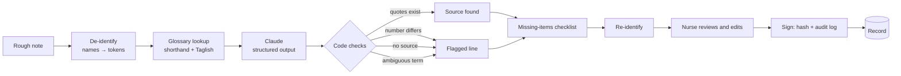
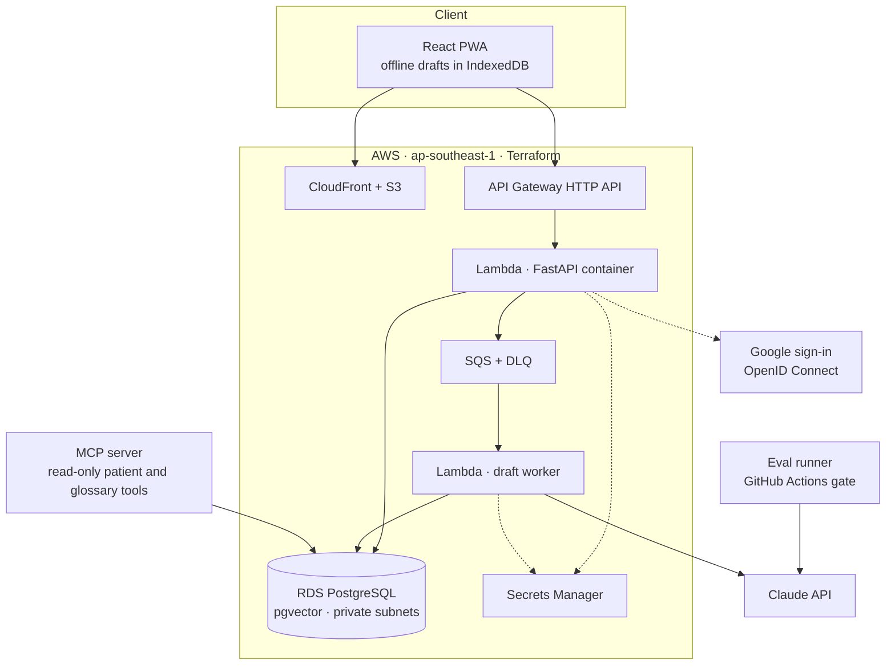

# Nursing Documentation AI

**Turn a nurse's rough shift notes into structured, source-checked SOAPIE/FDAR notes and SBAR handoffs.
The model writes, code checks, the nurse signs.**

> **Status: in development (pre-release).** The architecture and roadmap below are the plan. Features
> are checked off as they ship, and evaluation results will be published here when they exist.
> All patient data in this repository is synthetic.

---

## The problem

Nurses document constantly, often in a hurry and in a mix of English and Filipino (Taglish), with
shorthand like `c/o`, `IVF`, `@ 30 gtts/min`. Turning that into a formal note format takes time
away from patients, and an AI that "cleans it up" is dangerous if it quietly adds a fact the nurse
never wrote.

## The approach

Every line of an AI draft must point to the exact words it came from. Code, not the model, checks
that those words exist and that every number matches. Anything unsupported is flagged, never shown
as fact, and nothing enters the record until a nurse reviews and signs it. Ward shorthand and Taglish
terms are looked up in a reviewed glossary rather than guessed, and a term with more than one meaning
(`MS` can be morphine sulfate or magnesium sulfate) is flagged for the nurse, never expanded.

**Example (synthetic).** Rough note:

```text
pt c/o hilo since 2am, BP 90/60 HR 112. pinainom ng water 200ml, still weak.
IVF D5LR 1L @ 30gtts/min infusing well L arm
```

Draft FDAR note with its checks:

| | Line | Source words | Check |
|---|---|---|---|
| **F** | Dizziness with low blood pressure | "c/o hilo since 2am, BP 90/60" | AI wording, nurse confirms · glossary: c/o, hilo |
| **D** | Reports dizziness since 2 AM. BP 90/60 mmHg, HR 112 bpm. IVF D5LR 1 L at 30 gtts/min, left arm, infusing well. | "c/o hilo since 2am", "BP 90/60 HR 112", "IVF D5LR 1L @ 30gtts/min infusing well L arm" | Source found, numbers match · glossary: c/o, hilo, IVF, gtts |
| **A** | Given 200 mL water orally. | "pinainom ng water 200ml" | Source found · glossary: pinainom |
| **R** | Still weak. | "still weak" | Source found |
| | *Missing items:* allergies not documented, fall risk not documented | (checklist, plain code) | Needs nurse |

*Glossary* lists the reviewed entries that explained a term in the line's source words (for example
*hilo* = dizziness, *pinainom* = given to drink). An entry explains a word only: the quote, number and
medicine checks still use the nurse's own words.

The model is not allowed to invent an action the nurse didn't write (for example "notified physician").
Empty sections stay empty and are flagged for the nurse.

---

## Features (planned)

- [ ] **Rough note → FDAR or SOAPIE note**, with the format set per facility
- [ ] **Source-linked lines:** every line carries its source quotes; code verifies the quotes and the numbers
- [ ] **De-identification before any AI call:** names and identifiers become tokens; the AI provider never sees who the patient is
- [ ] **Missing-items checklist** (plain code, no AI): allergies, code status, pending labs, IV lines, fall risk, medications due
- [ ] **Review and sign:** signed notes are immutable and hashed
- [ ] **Sign in with Google** (OpenID Connect, invite-only, no account passwords stored), with demo personas for visitors
- [ ] **Built for shared ward PCs:** idle lock, and a personal signing PIN for unlocking and for every signature, so the next nurse can't act as the last one
- [ ] **Eval harness** with a nurse-written gold set and a CI quality gate
- [ ] **Glossary lookup for ward shorthand and Taglish:** retrieval-augmented generation (RAG) with hybrid search (exact, fuzzy and semantic) in PostgreSQL with pgvector; it explains words and never suggests care, and a term with more than one meaning is flagged, never guessed
- [ ] **Append-only, hash-chained audit log** of every view, edit, signature and agent tool call
- [ ] **MCP server** with read-only patient and glossary tools, and an agent mode that chooses its own tools
- [ ] **SBAR shift handoff** drafted from the nurse's notes for the shift and the patient's context, with the same checks, then signed by the outgoing nurse
- [ ] **Amendments:** edits after signing become a new version that points to the old one
- [ ] **Ward board** for head nurses: who still needs a signed note or handoff this shift
- [ ] **Print to A4**, and **offline drafts** for slow ward internet

**Out of scope:** billing, pharmacy, lab systems, insurance claims and anything else a hospital
information system covers. This is a documentation module that sits beside one.

---

## How a draft is made



AI generation runs as an asynchronous job. The API answers right away with `202 Accepted` and a job
ID, a worker calls the model, and the app shows progress. That way slow responses never time out,
and retries are safe thanks to idempotency keys.

The glossary lookup runs on the de-identified note and combines three searches in PostgreSQL: exact
and variant matches, trigram similarity for misspellings (pg_trgm), and vector similarity for meaning
(pgvector), merged with reciprocal rank fusion. The matched entries go to the model as context.

## Architecture



A shared Python `core` package holds the domain logic and the draft pipeline. The FastAPI app, the
MCP server and the eval runner are three thin entry points over that one core.

Sign-in follows the backend-for-frontend pattern: the API completes the Google OpenID Connect flow
and gives the browser only an `httpOnly` session cookie, so no tokens are ever stored in the browser.
Ward PCs are shared, and Google keeps the last user signed in even after they leave the app, so Google
only proves who starts the shift. A short personal PIN (stored as an Argon2id hash) unlocks the screen
after an idle lock and is required for every signature.

---

## Evaluation

Every prompt or model change is measured against a gold set of synthetic cases written by a
registered nurse before it ships.

| Metric | How it is checked |
|---|---|
| Fact recall | Share of required facts present (code match + LLM judge, judge checked against nurse ratings) |
| Unsupported lines | Lines whose source quote is not in the input (code only) |
| Number mismatches | Numbers in a line that don't appear in its source (code only) |
| Critical items missed | Gold-set critical items missing from the output (code only) |
| PHI leaks | Identifiers that reached the AI provider (must be 0) |
| Shorthand and Taglish terms | Expected meanings present, and terms given a wrong meaning (code match + LLM judge) |
| Ambiguous terms flagged | Terms with more than one meaning flagged instead of expanded (code only) |
| Run-to-run variance | Each case run 5 times |
| Cost and time per note | Tokens and seconds logged per call |

**Results:** to be published here once the harness runs. Planned comparisons: model vs model, prompt
v1 vs v2, no glossary vs the whole glossary in the prompt vs retrieved entries, and the agent with
tools vs without. If the whole glossary in a cached prompt beats retrieval at this size, the report
will say so.

**CI gate:** a pull request that changes a prompt or the pipeline runs the gold set. A drop in recall
or in ambiguous terms flagged, or any rise in unsupported lines, missed critical items, misread terms
or PHI leaks, fails the build.

---

## Tech stack

| Layer | Choices |
|---|---|
| API | Python 3.13, FastAPI, Pydantic v2, SQLAlchemy 2.0 (async), Alembic, PostgreSQL 17 with pgvector and pg_trgm |
| AI | Anthropic Claude (structured output), provider interface with fake and replay providers so tests and the demo cost $0 |
| Retrieval (RAG) | Glossary lookup with hybrid search: exact and variant match, trigram similarity (pg_trgm) and vector similarity (pgvector), merged with reciprocal rank fusion; embedding model chosen by benchmark (local vs hosted) and recorded in an ADR |
| Auth | Google OpenID Connect (Authorization Code + PKCE) through the API, server-side sessions, role-based access, idle lock + signing PIN (Argon2id) for shared PCs |
| Web | React 19, TypeScript, Vite, TanStack Router + Query, Tailwind CSS v4, shadcn/ui, PWA |
| Agent tools | Model Context Protocol (MCP) server in Python |
| Infrastructure | AWS Lambda, API Gateway, SQS, RDS, S3, CloudFront, Secrets Manager. All in Terraform. |
| Quality | pytest, Hypothesis, Testcontainers, Vitest, Playwright, axe, Ruff, Pyright (strict), ESLint |
| CI/CD | GitHub Actions, OIDC to AWS (no stored keys), eval gate, Terraform plan/apply |

Built test-first: every behaviour starts as a failing test, and every push runs linting, type
checks, unit and integration tests against a real PostgreSQL, and browser tests in GitHub Actions.
Major decisions are recorded as ADRs in [`docs/adr/`](docs/adr/).

## Repository layout

```text
core/     domain model, draft pipeline, de-identification, providers, database layer
api/      FastAPI app (HTTP entry point)
mcp/      MCP server (agent entry point)
evals/    gold-set cases, runner, metrics, reports
web/      React + TypeScript ward app
infra/    Terraform for AWS
docs/     architecture notes and ADRs
```

## Getting started

> Available after the first milestone. Planned workflow:

```bash
make dev      # Postgres + API + web, with the fake AI provider (no API key needed)
make check    # lint, type-check and test everything
make e2e      # Playwright end-to-end tests
```

---

## Roadmap

Each release ships one complete feature through every layer, from the screen to the database.

- [ ] **v0.1** Foundation: monorepo, Docker Compose, CI
- [ ] **v0.2** First feature, end to end: rough note → checked FDAR draft with source highlights → edit → sign
- [ ] **v0.3** Live on AWS: Terraform, continuous deployment, Google sign-in, async drafts on SQS
- [ ] **v0.4** Eval harness with a CI gate and first published results, plus glossary lookup for ward shorthand (hybrid search with pgvector)
- [ ] **v0.5** MCP server and tool-using agent: read-only patient and glossary tools, every call in a hash-chained audit log, a draft SBAR handoff, and an eval comparison
- [ ] **v0.6** Full ward: SOAPIE, amendments, SBAR handoff screen and signing, ward board, A4 print, offline drafts
- [ ] **v1.0** Launch: results, demo video, security review

See [CHANGELOG.md](CHANGELOG.md) for what has shipped.

---

## Safety and privacy

- **A documentation aid, not a medical device.** It gives no clinical advice; a nurse reviews and
  signs every note.
- **Synthetic data only** in this repository: no real names, hospital numbers or patient details.
- **De-identification before AI calls**, and logging that never records note text or names.
- Any real-world use would require the facility's own data-privacy approval (in the Philippines,
  under the Data Privacy Act of 2012), a data processing agreement and a privacy impact assessment.

## Acknowledgements

Built with clinical input from a registered nurse, who writes and reviews the evaluation cases.

## License

Copyright © 2026 Ronald Allan Rivera. All rights reserved. The source is published for review only.
